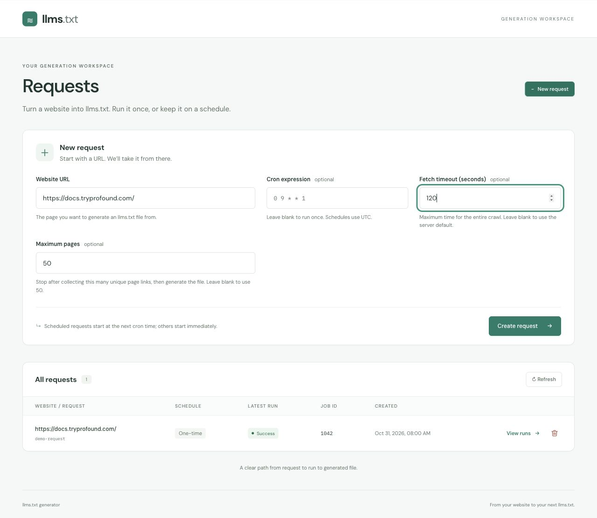
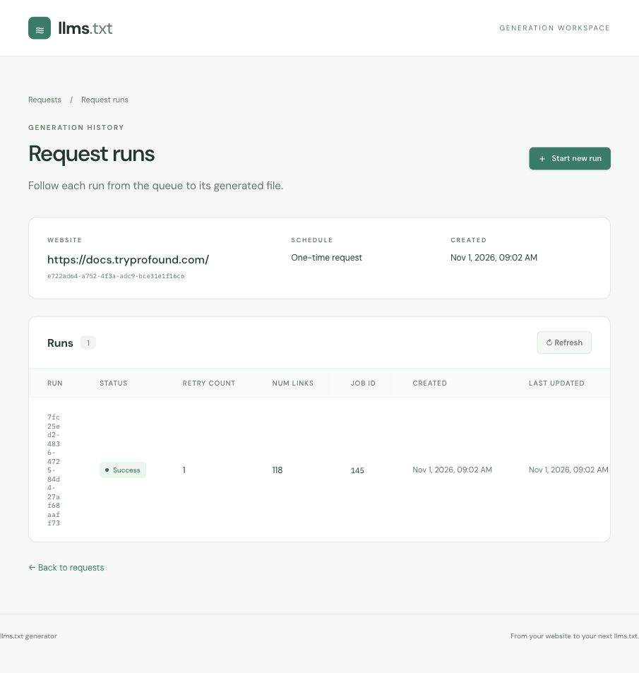
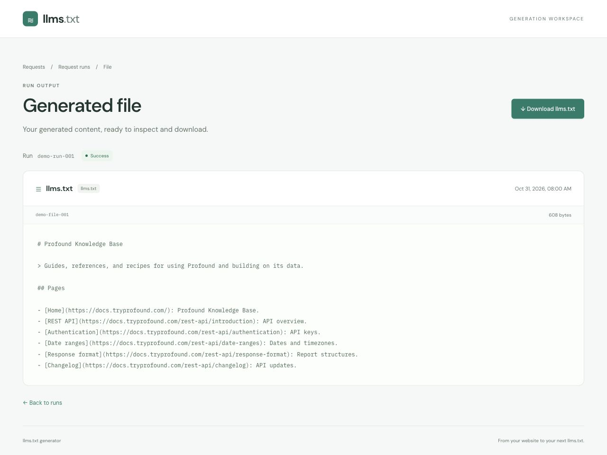

# Demo: generate llms.txt from a website

Use **https://docs.tryprofound.com/** with **Maximum pages: 250** and
**Maximum depth: 3**.

## 1. New request

Enter the URL and limits, then select **Create request**.

## 2. Request runs

Follow the run until it succeeds, then select **View file**.

## 3. Generated file

Review the generated content and select **Download llms.txt** to save it.

