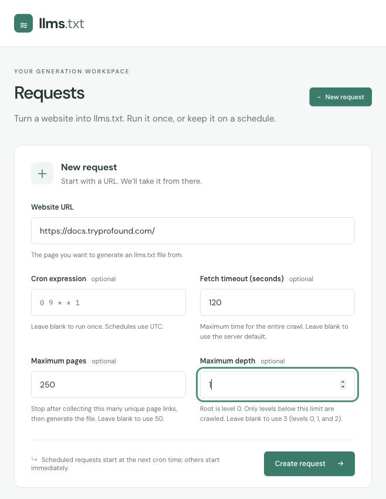
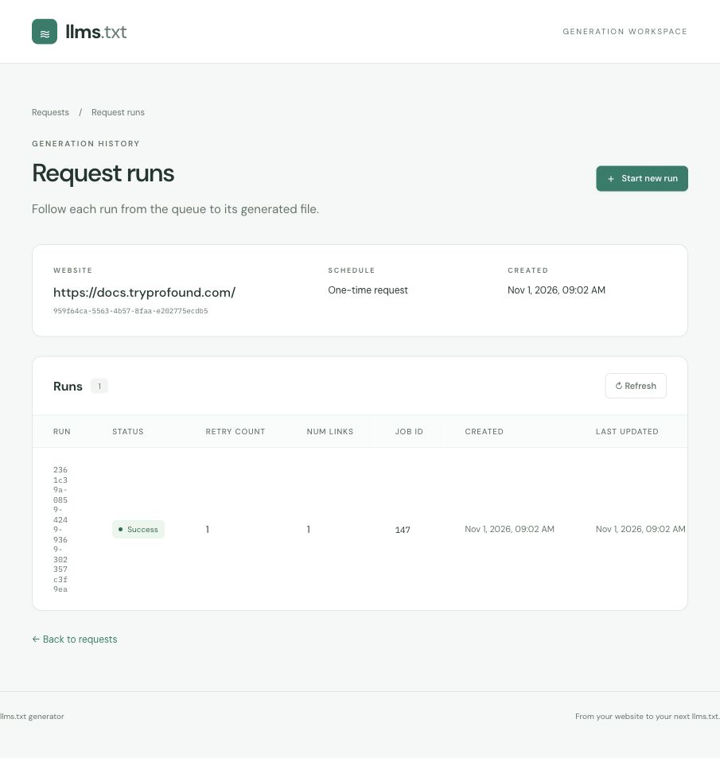

# Demo: from a website to llms.txt

Turn a website into a downloadable Markdown index of its pages. Create a crawl
request, follow its run, and inspect the generated `llms.txt`.

These screenshots show live crawls of
[Profound’s documentation](https://docs.tryprofound.com/), captured on
November 1, 2026. Both examples use a **250-page limit** and a **120-second
timeout**. The first uses maximum depth 3; the comparison uses maximum depth 1.
Page counts can change as the website changes.

## 1. Create a request

Open **Requests**, select **New request**, and enter the starting page's HTTP(S)
URL: **https://docs.tryprofound.com/**. Set **Fetch timeout (seconds)** to
**120**, **Maximum pages** to **250**, and **Maximum depth** to **3**.

Maximum depth is an exclusive limit on the number of link hops from the root:

| Level | Pages | With maximum depth 3 |
| --- | --- | --- |
| 0 | The requested URL | Included |
| 1 | Pages linked directly from the root | Included |
| 2 | Pages linked from level 1 | Included |
| 3 and above | Further descendants | Not queued |

Depth counts links, not URL path segments. The crawler follows links on the
starting URL's hostname and processes them breadth-first: all pages and retries
at one level finish before the next level starts. Pages within a level can run
concurrently. The 250-page cap applies across all levels, including the root;
it is a maximum, not a target number of pages to collect.

Leave **Cron expression** blank to run once immediately, then select
**Create request**. For recurring generation, enter a cron expression such as
`0 9 * * 1` for Mondays at 09:00 UTC; the first run starts at the next scheduled
time. If omitted, maximum depth defaults to 3, maximum pages defaults to 50, and
timeout uses the server default, normally 600 seconds. Maximum depth must be a
finite number greater than zero; fractional limits use the same comparison
(for example, 1.5 includes levels 0 and 1).

## 2. Follow the run

Creating a request opens **Request runs**. You can also reach it through
**View runs** on the Requests screen. This view shows each run's status,
retry count, number of links, job ID, and timestamps.

Pending runs refresh every five seconds. This captured run shows **Success** and
**118** links, below the 250-page cap. Select **View file** to inspect its output. Use
**Start new run** when you want another run immediately, including for a
request that already has a recurring schedule.

## 3. Inspect and download llms.txt

The **Generated file** screen displays the Markdown content and its size.
Review the page titles, URLs, and descriptions, then select
**Download llms.txt** to save the plain-text file.

This output includes the Profound Knowledge Base, Agency Mode, Agent Analytics,
Agents, Workflows, and other documentation pages. Titles and descriptions come
from the crawled pages' metadata. To publish it, upload the downloaded file to
your website so it is available at `/llms.txt`.

## 4. Compare with maximum depth 1

Create another request for **https://docs.tryprofound.com/** with the same
**250-page limit** and **120-second timeout**, but set **Maximum depth** to **1**.

Only the root at level 0 qualifies. Its direct links are level 1 and are never
queued, even though the page cap still allows up to 250 results.

This run succeeded with **1** link. Its generated file contains only the Profound
Knowledge Base root page. The two captured runs demonstrate the difference:

| Maximum depth | Eligible levels | Maximum pages | Links collected |
| --- | --- | --- | --- |
| 3 | 0, 1, 2 | 250 | 118 |
| 1 | 0 | 250 | 1 |

## Run the application yourself

Follow the [backend setup](../backend/README.md) to start the API, Postgres, and
background workers. Then follow the [frontend setup](../frontend/README.md) to
start the interface. The screenshots above document the workflow; generating
files from your own website requires those services to be running.
